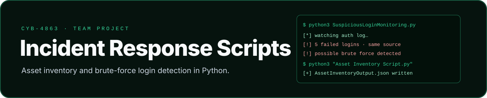

  

A **team project** for CYB-4863 at The University of Tulsa (Group 1, March 2025): a small Python toolkit for two
phases of incident response, **preparation** (knowing what's on a system) and **detection** (spotting brute-force
logins).

**Team:** Kayla Fredenburg, Mahin Moon, Alexis Watson, Benton Raymer, Xingzhou Li, Matthew Adams.
This repository is my fork of the team's repo.

## Contents

| File | Purpose |
|---|---|
| [`Asset Inventory Script.py`](Asset%20Inventory%20Script.py) | preparation: collects active users, installed software, missing patches and USB device history (Windows, via subprocess and registry queries) |
| [`AssetInventoryOutput.json`](AssetInventoryOutput.json) | sample inventory output |
| [`SuspiciousLoginMonitoring.py`](SuspiciousLoginMonitoring.py) | detection: watches for repeated failed logins |
| [`simulate_brute_force.sh`](simulate_brute_force.sh) | generates failed logins to test the detector |
| [`detection_log.txt`](detection_log.txt) · [`login-script-output.png`](login-script-output.png) | detector output |
| [`ScriptingProjectReport.md`](ScriptingProjectReport.md) | **the full report**: methodology, findings and reflections on automation |

The banner terminal is stylised. The screenshot above is the real output.
